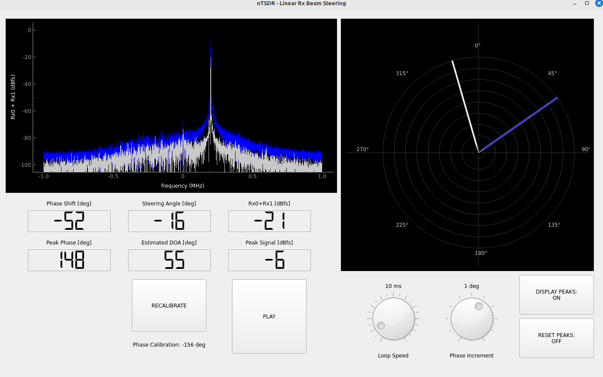
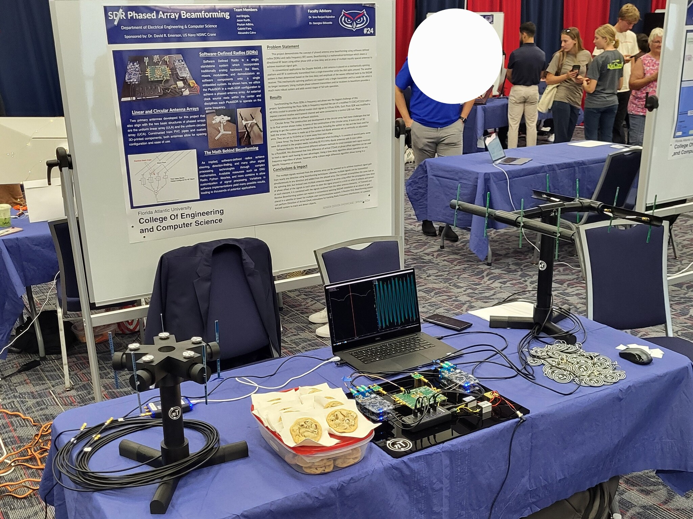

<div align="center">

# Formación de Haz en Arreglos de Fase con SDR
### Investigación e Implementación de Radio Definida por Software

[](https://github.com/ADolbyB/sdr-beamforming/stargazers)
[](https://github.com/ADolbyB/sdr-beamforming/network/members)
[](https://github.com/ADolbyB/sdr-beamforming)
[](https://github.com/ADolbyB/sdr-beamforming/commits/main)

**Proyecto Final de Ingeniería - Calificación: A**

[](https://www.python.org/)
[](https://www.gnuradio.org/)
[](https://www.riverbankcomputing.com/software/pyqt/)

**Desarrollado por:** [](https://github.com/ADolbyB) & [](https://github.com/peyton127)

</div>

---

## 📡 Descripción General del Proyecto

Este repositorio documenta un proyecto integral de investigación e implementación para **formación de haz en arreglos de fase con radio definida por software (SDR)**. Originalmente enfocado en evaluar la plataforma PlutoSDR, el proyecto evolucionó a una iniciativa de investigación SDR multiplataforma que explora diversas arquitecturas de formación de haz, sistemas con coherencia de fase y aplicaciones de localización de dirección.

**Áreas de Enfoque de la Investigación:**
- Sistemas SDR de múltiples canales con coherencia de fase
- Algoritmos de formación de haz digital e implementación
- Comunicaciones inalámbricas MIMO (Múltiples Entradas, Múltiples Salidas)
- Estimación de Dirección de Llegada (DoA)
- Sistemas de radar pasivo
- Técnicas de sincronización de hardware de RF

---

## 🎯 Objetivos del Proyecto

| Objetivo | Estado | Descripción |
|-----------|--------|-------------|
| **Evaluación de Hardware** | ✅ Completo | Comparar múltiples plataformas SDR para aplicaciones de formación de haz |
| **Coherencia de Fase** | ✅ Completo | Lograr operación multicanal sincronizada en fase |
| **Desarrollo de GUI** | ✅ Completo | Crear interfaz de control intuitiva en PyQt5 |
| **Demo de Orientación de Haz** | ✅ Completo | Demostrar control en tiempo real de la dirección del haz |
| **Documentación** | ✅ Completo | Compilación integral de investigación y referencias |

**Calificación Final: A** - Demostración exitosa de formación de haz con coherencia de fase y control personalizado por GUI

---

## 🖥️ GUI del Proyecto

Interfaz gráfica interactiva de PyQt5 para el control y la visualización en tiempo real de la orientación del haz.

[](https://github.com/RayzrReptile/PyQT_GUI)

**Características de la GUI:**
- Control de fase en tiempo real para elementos individuales de la antena
- Visualización del patrón del haz
- Ajuste interactivo del ángulo de orientación
- Monitoreo de intensidad de señal
- Interfaz de configuración de hardware

**Repositorio:** Visite el [Repositorio del Proyecto PyQT_GUI](https://github.com/RayzrReptile/PyQT_GUI) dedicado para obtener detalles de implementación.

*Desarrollado por [@RayzrReptile](https://github.com/RayzrReptile)*

---

## 🛠️ Plataformas de Hardware Evaluadas

### Plataformas SDR

| Plataforma | Canales | Rango de Frecuencia | Coherencia de Fase | Costo | Notas |
|----------|----------|-----------------|----------------|------|-------|
| **PlutoSDR** | 1 TX / 1 RX | 325 MHz - 3.8 GHz | ⚠️ Requiere reloj externo | ~$150 | Plataforma inicial, requiere sincronización |
| **KrakenSDR** | 5 RX | 24 MHz - 1.766 GHz | ✅ Nativa | ~$300 | Excelente para DoA |
| **AD-FMCOMMS5-EBZ** | 4 TX / 4 RX | 70 MHz - 6 GHz | ✅ Nativa | ~$1,445 | 2x AD9361, ideal para prototipado |
| **USRP B210** | 2 TX / 2 RX | 70 MHz - 6 GHz | ✅ Nativa | ~$2,165 | Solución profesional |
| **ADI CNO566 Phaser** | 2 TX / 2 RX | 8 GHz - 16 GHz | ✅ Nativa | ~$2,500 | Aplicaciones de alta frecuencia |
| **USRP N310** | 4 TX / 4 RX | 10 MHz - 6 GHz | ✅ Nativa | ~$17,765 | Nivel empresarial |

### Fuentes de Reloj Externas

**Crítico para la Sincronización de Fase Multicanal PlutoSDR:**

| Fuente de Reloj | Tipo | Rango de Frecuencia | Precisión | Costo |
|--------------|------|-----------------|----------|------|
| **TI CDCLVC1310-EVM** | Onda Cuadrada | 1 MHz - 200 MHz | Estándar | ~$30 |
| **Leo Bodnar Mini GPS** | GPSDO | 400 Hz - 810 MHz | Disciplinado por GPS | ~$150 |
| **Leo Bodnar LBE-1420** | GPSDO | 1 Hz - 1.1 GHz | Disciplinado por GPS | ~$200 |

**Nota:** Se probó con éxito el TI CDCLVC1310-EVM con un cristal de reemplazo de 40 MHz para la sincronización de PlutoSDR.

---

## 📚 Estructura del Repositorio

```
sdr-beamforming/
├── PhaseCoherence/         # Experimentos de sincronización de fase
│   ├── assets/             # Capturas de pantalla de GUI y diagramas
│   └── qtgui/              # Script final de alineación de fase para coherencia de fase.
├── Research/               # Documentos académicos y papeles de investigación
│   ├── AnalogDevices/      # Papeles de investigación para formación de haz
│   ├── Gabriel/            # Investigación de Gabriel: Recursos de aprendizaje
│   ├── Jason/              # Investigación de Jason: Recursos de aprendizaje
│   ├── Joel/               # Investigación de Joel: Recursos de aprendizaje
│   ├── Peyton/             # Investigación de Peyton: Recursos de aprendizaje
│   └── Testing/            # Instrucciones de compilación y prueba
├── Toolbox/                # Herramientas adicionales, scripts y capturas para pruebas y depuración
│   ├── GNURadio/           # Archivos de flujo de GNU Radio para pruebas y depuración con PlutoSDR
│   │   └── README.md       # Enlaces de corrección de errores y tutoriales para GNU Radio
│   ├── KrakenSDR/          # Scripts específicos de KrakenSDR para pruebas y depuración
│   │   └── README.md       # Notas sobre la implementación de KrakenSDR
│   └── PlutoSDR/           # Scripts de PlutoSDR para pruebas y depuración
│   │   └── README.md       # Modificaciones y fuentes de PlutoSDRs para 2 canales TX & 2 RX
└── README.md               # Este documento
```

---

## 🔬 Implementación Técnica

### Metodología de Coherencia de Fase

**Desafío:** Lograr operación bloqueada en fase entre múltiples unidades SDR independientes.

**Solución:**
1. **Distribución de Reloj Externo**
   - Reloj de referencia de 40 MHz desde TI CDCLVC1310-EVM
   - Cables SMA a u.FL para modificación de PlutoSDR
   - Dispositivos SDR y cables coaxiales SMA para reloj y RF

2. **Sincronización de Software**
   - Bloques de alineación temporal de GNU Radio
   - Scripts de calibración de fase personalizados en Python
   - Corrección de desplazamiento de fase en tiempo real

3. **Algoritmo de Formación de Haz**
   - Cambio de fase digital en banda base
   - Formación de haz con suma ponderada
   - Orientación de nulos adaptativa

### Arquitectura del Sistema

```
[Transmisor] → [Arreglo de Antenas] → [Canales RX de SDR] → [GNU Radio] → [GUI PyQt5]
                                         ↓
                                  [Alineación de Fase]
                                         ↓
                                  [Procesamiento DSP de Formación de Haz]
                                         ↓
                                  [Salida de Dirección]
```

---

## 📖 Recursos Clave de Investigación

### Sincronización de Fase

- [Generación de Señales Multicanal Estables en Fase](https://www.keysight.com/blogs/en/tech/rfmw/2019/04/10/how-to-generate-multi-channel-phase-stable-and-phase-coherent-signals) - Keysight Technologies
- [Alineación Temporal y de Fase Multicanal](https://www.keysight.com/blogs/en/tech/rfmw/2019/04/18/how-to-perform-multi-channel-timing-and-phase-alignment) - Keysight Technologies
- [Alineación de Fase Entre Múltiples Transmisores](https://www.freepatentsonline.com/y2016/0308598.html) - Documentación de patentes

### Recursos de Analog Devices

- [Plataforma de Desarrollo ADI CNO566 para Arreglos de Fase](https://www.analog.com/en/resources/reference-designs/circuits-from-the-lab/cn0566.html)
- [Soluciones de Arreglos de Fase ADI](https://www.analog.com/en/applications/markets/aerospace-and-defense-pavilion-home/phased-array-solution.html)
- [Placa de Evaluación ADAR-1000](https://www.analog.com/en/resources/evaluation-hardware-and-software/evaluation-boards-kits/EVAL-ADAR1000.html)

### Repositorios Esenciales de GitHub

| Repositorio | Autor | Descripción |
|------------|--------|-------------|
| [Pluto_Beamformer](https://github.com/jonkraft/Pluto_Beamformer) | Jon Kraft | Implementación de formación de haz con PlutoSDR |
| [PlutoSDR_Labs](https://github.com/jonkraft/PlutoSDR_Labs) | Jon Kraft | Experimentos educativos SDR |
| [PhasedArray](https://github.com/jonkraft/PhasedArray) | Jon Kraft | Formación de haz con ADAR-1000 |
| [krakensdr_doa](https://github.com/krakenrf/krakensdr_doa) | KrakenRF | Algoritmos de localización de dirección |
| [krakensdr_pr](https://github.com/mfkiwl/krakensdr_pr) | mfkiwl | Implementación de radar pasivo |
| [rtl-sdr](https://github.com/osmocom/rtl-sdr) | osmocom | Biblioteca de controladores RTL-SDR |
| [multi-rtl](https://github.com/ptrkrysik/multi-rtl) | ptrkrysik | Sincronización RTL-SDR |
| [gr-iio](https://github.com/analogdevicesinc/gr-iio) | Analog Devices | Bloques IIO para GNU Radio |
| [gnuradio](https://github.com/gnuradio/gnuradio) | GNU Radio | Marco central SDR |

---

## 📐 Teoría y Diseño de RF

### Conceptos Fundamentales

**Tecnología MIMO:**
- [Comprensión de los Fundamentos de MIMO](https://www.rfmw.com/data/swa-mimo-basics.pdf) - SWA
- [Visión Técnica de MIMO](https://www.keysight.com/us/en/lib/resources/training-materials/technical-overview-of-mimo-1179977.html) - Keysight
- [El SDR se encuentra con el Diseño MIMO](https://www.eetimes.com/tutorial-sdr-meets-mimo-or-all-you-need-to-know-about-designing-mimo-with-a-software-defined-radio/) - EE Times
- [Fundamentos de Sistemas de Radio MIMO](https://www.ezurio.com/resources/white-papers/basics-of-mimo-radio-systems) - Ezurio

**Procesamiento de Señales:**
- [Datos I/Q para Principiantes](http://whiteboard.ping.se/SDR/IQ) - Explicación visual
- [Procesamiento de Señales I/Q en SDR](https://www.allaboutcircuits.com/technical-articles/how-to-process-iq-signals-software-defined-rf-receiver-dsp-digital-signal/) - All About Circuits
- [La Transformada de Fourier](https://www.thefouriertransform.com/) - Sitio web interactivo
- [Señales en Cuadratura](https://www.mathworks.com/content/dam/mathworks/mathworks-dot-com/moler/quad.pdf) - MATLAB

### Materiales Educativos

**Recursos en Video:**
- [¿Qué es la Formación de Haz?](https://www.youtube.com/watch?v=VOGjHxlisyo)
- [¿Qué son los Arreglos de Fase?](https://www.youtube.com/watch?v=9WxWun0E-PM)
- [Ventajas de la Formación de Haz Digital](https://www.youtube.com/watch?v=Hb6BhqOgmAI)
- [Sistemas SDR y Análisis](https://www.youtube.com/playlist?list=PLBfTSoOqoRnOTBTLahXBlxaDUNWdZ3FdS) - Serie de 26 lecciones

**Libros y Guías:**
- [SDR para Ingenieros](https://www.analog.com/en/education/education-library/software-defined-radio-for-engineers.html) - Analog Devices
- [SDR Expediente de Campo Vol. 1-3](https://www.factorialabs.com/fieldxp/) - Implementaciones prácticas
- [Manual de Antenas en Arreglos de Fase](http://twanclik.free.fr/electricity/electronic/pdfdone11/Phased.Array.Antenna.Handbook.Artech.House.Publishers.Second.Edition.eBook-kB.pdf)
- [Teoría de Antenas: Análisis y Diseño](https://cds.cern.ch/record/1416310/files/047166782X_TOC.pdf)

**Serie LibreTexts de Ingeniería:**
1. [Fundamentos de Diseño de Microondas y RF](https://eng.libretexts.org/Bookshelves/Electrical_Engineering/Electronics/Book%3A_Fundamentals_of_Microwave_and_RF_Design_(Steer))
2. [Sistemas de Radio](https://eng.libretexts.org/Bookshelves/Electrical_Engineering/Electronics/Microwave_and_RF_Design_I_-_Radio_Systems_(Steer))
3. [Líneas de Transmisión](https://eng.libretexts.org/Bookshelves/Electrical_Engineering/Electronics/Microwave_and_RF_Design_II_-_Transmission_Lines_(Steer))
4. [Redes](https://eng.libretexts.org/Bookshelves/Electrical_Engineering/Electronics/Microwave_and_RF_Design_III_-_Networks_(Steer))
5. [Módulos](https://eng.libretexts.org/Bookshelves/Electrical_Engineering/Electronics/Microwave_and_RF_Design_IV%3A_Modules_(Steer))
6. [Amplificadores y Osciladores](https://eng.libretexts.org/Bookshelves/Electrical_Engineering/Electronics/Microwave_and_RF_Design_V%3A_Amplifiers_and_Oscillators_(Steer))

### Diseño de Antenas

**Recursos:**
- [Teoría de Antenas](https://www.antenna-theory.com/) - Sitio web integral
- [Tutorial de Diagrama de Smith](https://www.antenna-theory.com/tutorial/smith/chart.php) - Herramienta esencial
- [Antenas MIMO Explicadas](https://www.waveform.com/a/b/guides/mimo-antenna-guide) - Waveform

**Software de Modelado (Windows):**
- [EZNEC Antenna Software](https://eznec.com/) - Modelado profesional de antenas
- [4nec2](https://www.qsl.net/4nec2/) - Modelador basado en NEC gratuito

---

## 🔧 Equipos de Prueba y Herramientas

### Equipos de Laboratorio Recomendados

**Análisis de Espectro:**
- **TinySA Ultra** (~$150) - 0.1 MHz a 5.3 GHz
  - [Wiki Oficial](https://tinysa.org/wiki/pmwiki.php?n=Main.HomePage)
  - Portátil, alimentado por batería, excelente para trabajo de campo

**Análisis de Red:**
- **NanoVNA** (~$120) - Analizador de Redes Vectoriales
  - [Sitio Oficial](https://nanovna.com/)
  - [Guía para Principiantes PDF](http://www.nemarc.org/Absolute_Beginner_Guide_NanoVNA.pdf)
  - [Rutina de Calibración](https://nanovna.com/?page_id=2)
- **NanoRFE VNA6000** (~$789) - 5 kHz a 6 GHz
  - VNA portátil de nivel profesional

**Osciladores Disciplinados por GPS:**
- [Guía de GPSDO del NIST](https://www.nist.gov/publications/use-gps-disciplined-oscillators-primary-frequency-standards-calibration-and-metrology)
- [Guía de GPSDO para Principiantes QSL.net](https://www.qsl.net/zl1bpu/PROJ/NGPSDO/GPSDO%20Beginner.PDF)

### Herramientas de Software

**Linux & Windows:**
- [QtTinySA](https://github.com/g4ixt/QtTinySA) - GUI de escritorio para TinySA

**Linux:**
- [GQRX](https://gqrx.dk/) - Receptor de radio definida por software

**Windows:**
- [SDR#](https://airspy.com/download/) - Software SDR popular
- [SDR Console](https://www.sdr-radio.com/) - Características avanzadas
- [HDSDR](http://www.hdsdr.de/) - Software SDR clásico
- [DSD+](https://www.dsdplus.com/) - Decodificador de señal digital
- [Unitrunker](http://www.unitrunker.com/) - Decodificador de radio enjaulada

---

## 🚀 Primeros Pasos

### Prerrequisitos

**Hardware:**
- Plataforma SDR (PlutoSDR, KrakenSDR o USRP)
- Fuente de reloj externo (para sincronización de múltiples unidades)
- Arreglo de antenas (dipolos, parches o helicoidales)
- Cables y adaptadores de RF

**Software:**
- Python 3.8+
- GNU Radio 3.8+
- PyQt5
- NumPy, SciPy, Matplotlib

### Instalación

```bash
# Clonar el repositorio
git clone https://github.com/ADolbyB/sdr-beamforming.git
cd sdr-beamforming

# Instalar GNU Radio (Ubuntu/Debian)
sudo apt-get install gnuradio

# Para soporte de PlutoSDR
sudo apt-get install libiio-utils
```

### Inicio Rápido

1. **Configurar Hardware**
   - Conectar fuente de reloj externo (obligatorio si se usan múltiples SDR)
   - Adjuntar arreglo de antenas con espaciamiento adecuado (λ/2 recomendado)
   - Conectar las unidades SDR al equipo host mediante un hub USB.

2. **Ejecutar GUI de Calibración de Fase**
   ```bash
   cd PhaseCoherence/qtgui
   python RxBeamSteer_GUI.py
   ```

3. **Iniciar Formación de Haz**
   - Cargar el grafo de flujo de GNU Radio
   - Ajustar el ángulo de orientación del haz a través de la GUI
   - Monitorear la salida en tiempo real

---

## 🎓 Contexto Académico

**Curso:** Proyecto de Diseño de Ingeniería Avanzado  
**Institución:** *Universidad Atlántica de la Florida*  
**Semestre:** *Otoño 2023 - Primavera 2024*  
**Calificación Final:** **A**

**Miembros del Equipo:**
- [Joel Brigida](https://github.com/ADolbyB) - Integración de hardware, pruebas de RF, documentación
- [Peyton Adkins](https://github.com/peyton127) - Desarrollo de software, diseño de GUI, procesamiento de señales
- [Jason Kurth](https://www.jasonkurthphoto.com/) - Diseño de hardware y prototipado
- [Alexandra Calvo](https://www.linkedin.com/in/alexandra-calvo-9973008a/) - Diseño de hardware, diseño de antenas, documentación
- [Gabriel Faro](https://www.linkedin.com/in/gabriel-faro/) - Diseño de hardware, impresión 3D, documentación

**Ámbito del Proyecto:**
Este proyecto final exploró la implementación práctica de la formación de haz en arreglos de fase utilizando radios definidas por software. El equipo de cinco miembros evaluó múltiples plataformas SDR, desarrolló técnicas de sincronización de fase, diseñó arreglos de antenas personalizados, creó soluciones de montaje mecánico mediante impresión 3D y entregó un sistema de demostración funcional con capacidades de orientación de haz en tiempo real.

---

## 🖼️ Galería del Proyecto

### Configuración de Demostración en Vivo



**Demostración en la Exposición de Diseño Avanzado** - Universidad Atlántica de la Florida

Nuestro equipo presentó un sistema de formación de haz en arreglo de fase totalmente funcional en la Exposición de Diseño Avanzado de la Facultad de Ingeniería y Ciencias de la Computación de la FAU. La demostración incluyó:

**Hardware en Exhibición:**
- Múltiples unidades PlutoSDR con sincronización de reloj externo
- Sistemas de montaje de antenas impresos en 3D personalizados
- Configuraciones de arreglos de antenas lineales y circulares
- Visualización en vivo de formación de haz en tiempo real
- Presentación de póster profesional (Puesto #24)

**Capacidades Demostradas en Vivo:**
- Recepción de señal con coherencia de fase en tiempo real
- Control interactivo de orientación del haz mediante GUI de PyQt5
- Representación visual de la geometría del arreglo de antenas
- Estimación de dirección de llegada
- Procesamiento de señal multicanal en tiempo real

**Diseños de Arreglos de Antenas:**
- Arreglo Lineal Uniforme (ULA) para escaneo direccional
- Arreglo Circular Uniforme (UCA) para cobertura de 360°
- Elementos de antena dipolo personalizados (visibles en la demostración)
- Configuraciones de dipolos con espaciamiento preciso

> 📸 *La foto muestra la configuración completa de demostración, incluyendo PlutoSDRs sincronizados, arreglos de antenas, visualización en tiempo real de la GUI y el póster profesional del proyecto en la Exposición de Diseño Avanzado de la FAU.*

---

## 🌐 Aplicaciones del Mundo Real

**Usos Comerciales:**
- **Comunicaciones Inalámbricas:** Sistemas de antenas MIMO 5G
- **Sistemas de Radar:** Radar meteorológico de arreglo de fase, aplicaciones militares
- **Comunicaciones UAV:** Transmisión de video de alto ancho de banda desde drones
  - [Integración UAV StreamCaster](https://www.unmannedsystemstechnology.com/2022/09/streamcaster-radios-integrated-into-evtol-commerical-uav/)
- **Comunicaciones Tácticas:** [Radios StreamCaster de Silvus](https://silvustechnologies.com/products/streamcaster-radios/)

**Aplicaciones de Investigación:**
- Radioastronomía
- Radar pasivo
- Localización de dirección
- Guerra electrónica (defensiva)

---

## 📄 Licencia

Este proyecto está licenciado bajo la Licencia GNU GPL v3 - consulte el archivo [LICENSE.md](https://github.com/ADolbyB/sdr-beamforming/blob/main/LICENSE.md) para obtener detalles.

**Aviso de Integridad Académica:** Este repositorio representa trabajo académico completado. Si está matriculado actualmente en un curso similar, utilice esto solo como material de referencia y cumpla con las políticas de honestidad académica de su institución.

---

## 🤝 Contribuciones

Aunque este es un proyecto académico completado, damos la bienvenida a:
- Informes y correcciones de errores
- Mejoras de documentación
- Soporte para plataformas de hardware adicionales
- Algoritmos de procesamiento de señales mejorados

¡Por favor, abra un issue o envíe una solicitud de extracción (pull request)!

---

## 📞 Contacto y Agradecimientos

**Mantenedores del Proyecto:**
- [Joel Brigida](https://github.com/ADolbyB) - Integración de hardware, pruebas de RF, documentación
- [Peyton Adkins](https://github.com/peyton127) - Desarrollo de software, diseño de GUI, procesamiento de señales
- [Jason Kurth](https://www.jasonkurthphoto.com/) - Diseño de hardware y prototipado
- [Alexandra Calvo](https://www.linkedin.com/in/alexandra-calvo-9973008a/) - Diseño de hardware, diseño de antenas, documentación
- [Gabriel Faro](https://www.linkedin.com/in/gabriel-faro/) - Diseño de hardware, impresión 3D, documentación

**Patrocinio del Proyecto:**
- **Dr. David R. Emerson** - NSWC Crane de la Armada de EE. UU.
- Universidad Atlántica de la Florida - Facultad de Ingeniería y Ciencias de la Computación

**Apoyo Docente:**
- Dra. Sree Ranjani Rajendran - Asesora Docente
- Dr. Georgios Sklivanitis - Asesor Docente

**Agradecimientos Especiales:**
- Jon Kraft - Extensos recursos de formación de haz para PlutoSDR
- Analog Devices - Documentación de hardware y soporte
- Comunidad GNU Radio - Marco SDR de código abierto
- Equipo KrakenRF - Algoritmos de localización de dirección
- NIWC de la Armada de EE. UU. - Patrocinio y orientación del proyecto

**Apoyo a la Investigación:**
- Departamento de Ingeniería Eléctrica y Ciencias de la Computación de la FAU
- Socios de la industria y comunidad SDR de código abierto

---

## 📊 Estadísticas del Proyecto

<div align="center">


</div>

---

<div align="center">

**Avanzando la Tecnología RF a Través de la Investigación Abierta**

*Formación de Haz en Arreglos de Fase - De la Teoría a la Implementación*

[](https://github.com/ADolbyB)

</div>
